<p align="center">
  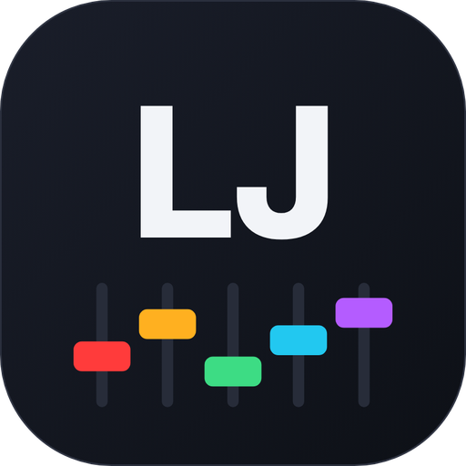
</p>

<h1 align="center">LJ Link</h1>

<p align="center">
  Show your LJ what the sound does.<br>
  Every deck, every waveform, every cue, live in one view.
</p>

<p align="center">
  <a href="https://skyplayser.github.io/LJ-Link/">Website</a> &nbsp;·&nbsp;
  <a href="https://github.com/skyplayser/LJ-Link/releases/latest">Download</a> &nbsp;·&nbsp;
  <a href="#quick-start">Quick start</a> &nbsp;·&nbsp;
  <a href="docs/anleitung.de.md">Anleitung (Deutsch)</a> &nbsp;·&nbsp;
  <a href="https://discord.gg/N6DMca4Bjk">Discord</a> &nbsp;·&nbsp;
  <a href="CONTRIBUTING.md">Contribute</a>
</p>

<p align="center">
  <a href="https://github.com/skyplayser/LJ-Link/actions/workflows/build.yml"></a>
</p>

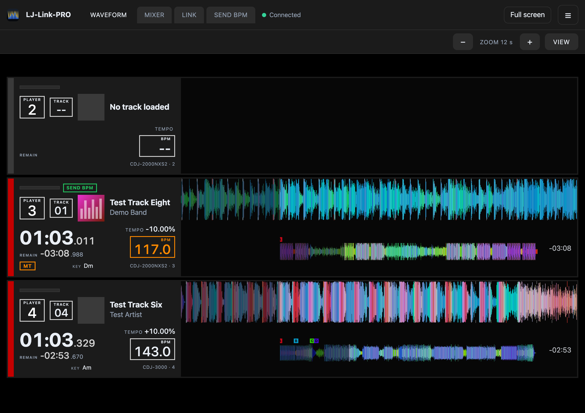

When the DJ loads a track, the lighting jockey has to know where it is, where the drop is and when the next phrase starts.
LJ Link listens to Pioneer Pro DJ Link and Denon StageLinQ and shows exactly that for all players at once, with a familiar
player layout (player and track boxes, time with milliseconds, tempo, BPM, key). It runs on your computer, opens in its own
window and can be watched on a tablet next to it.

It only listens to the DJ gear and never sends sync, master, tempo or fader commands to it. One exception is optional and off
by default: the Ableton Link output leads the tempo of a Link session, so Link programs in your network – including DJ software
such as Traktor if it joins the session – follow LJ Link's tempo. There is no telemetry. The only connection outside your
network is the update check: LJ Link asks GitHub for the newest version about 15 seconds after the start (only when the
program icon is shown) and when the interface is loaded, at most once an hour. Only the computer running LJ Link asks, also
when a tablet loads the page; GitHub sees its IP address and the program version. You can switch this off under *Settings → Updates → Check for updates automatically*;
*Check for updates* in the menu of the program icon still works (see
[Privacy](https://skyplayser.github.io/LJ-Link/datenschutz.html)).

## What you get

- **All decks in one view:** cover, title, elapsed and remaining time down to the millisecond, tempo and pitch, BPM, key, master,
  sync and the model of each player.
- **Waveforms like on the player:** a scrolling detail waveform and the whole-track overview, with hot cues A to H, memory cues,
  orange loops and the beat grid with bar starts in red.
- **A red LIVE frame** around the deck that is on air, so you never light the wrong track.
- **A Mixer tab** with one strip per channel, and a click on any player opens everything the interface reports about it.
- **Privacy mode** for streams and shared screens, switched only from the program icon.
- **Every maker in one view:** CDJs, XDJs and Denon controllers are found together and shown side by side. Two DJs with their own controller (say an XDJ-AZ and a Prime 4+)? Both appear. A device that joins later is added automatically, one that leaves disappears, and in the settings you can tick devices on or off, which helps with several floors on one network.
- **Denon / Engine DJ** (Prime 4, Prime 4+, Prime Go, SC6000) over StageLinQ: title, artist, tempo and pitch, play state, master, exact position, the real **fader positions** of the mixer, and the waveform with beat grid, bar starts, hot cues and loops read from the device's library. Passive: it never changes anything on the device.
- **Light desk link:** sends the tempo to grandMA2 and grandMA2 onPC (Telnet), grandMA3 and grandMA3 onPC (OSC) and any OSC program that reads a number ; Daslight over Ableton Link (recommended) or an OSC tap on every beat for its BPM Tap button (both work with Daslight); and, as an untested alpha, OSC taps for ChamSys MagicQ. *Search for the desk* finds a grandMA2
  (onPC or console) in the network; otherwise enter its IP address by hand.
- **SEND BPM:** a tab next to LINK chooses which deck gives the tempo, *Auto* (the deck that is master and/or live) or one deck by
  hand, and a green *SEND BPM* mark shows on that deck in every view, tablets included.
- **Updates from the icon:** *Check for updates* in the menu of the program icon downloads the new version and installs it; on a
  Mac the app is replaced and restarts by itself, on Windows the installer opens. A download is only installed if it matches
  the checksum GitHub publishes for it. By default LJ Link also checks by itself and tells you (can be switched off).
- **Easy to set up:** automatic search, or a guided check that tells you what to change in the network. A demo mode runs without hardware.
- **English and German**, day and night mode, RGB or blue waveforms, zoom, three views (both, detail, overview), full screen, and
  a layout that works from a phone to a big screen.

<table>
  <tr>
    <td width="50%">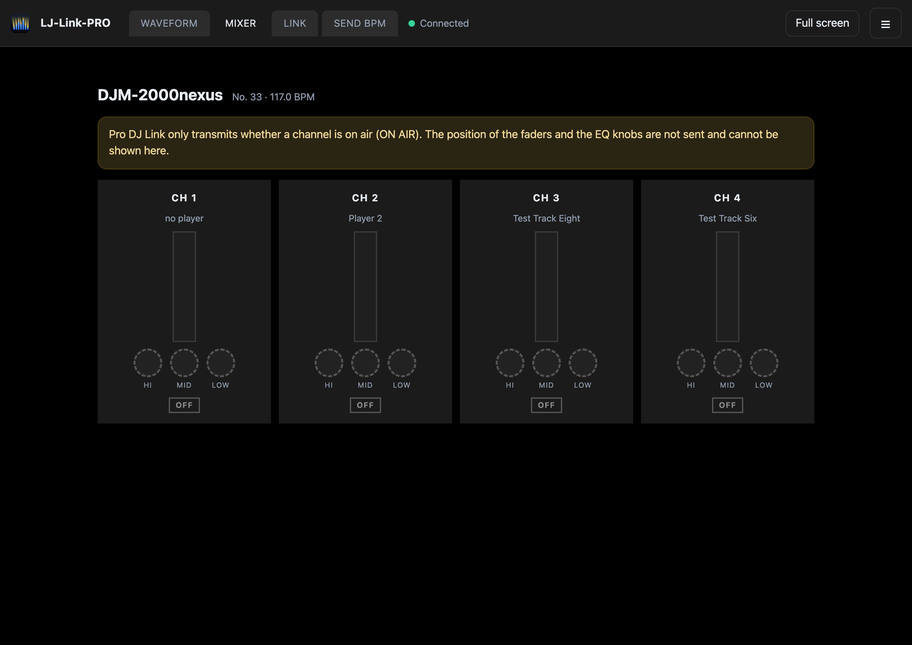<br><sub><b>Mixer tab.</b> Which channel is on air.</sub></td>
    <td width="50%">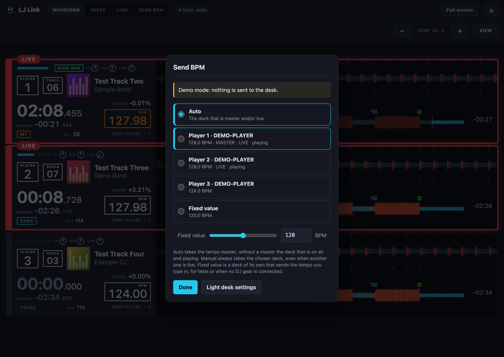<br><sub><b>SEND BPM.</b> Which deck gives the tempo to the light desk.</sub></td>
  </tr>
  <tr>
    <td>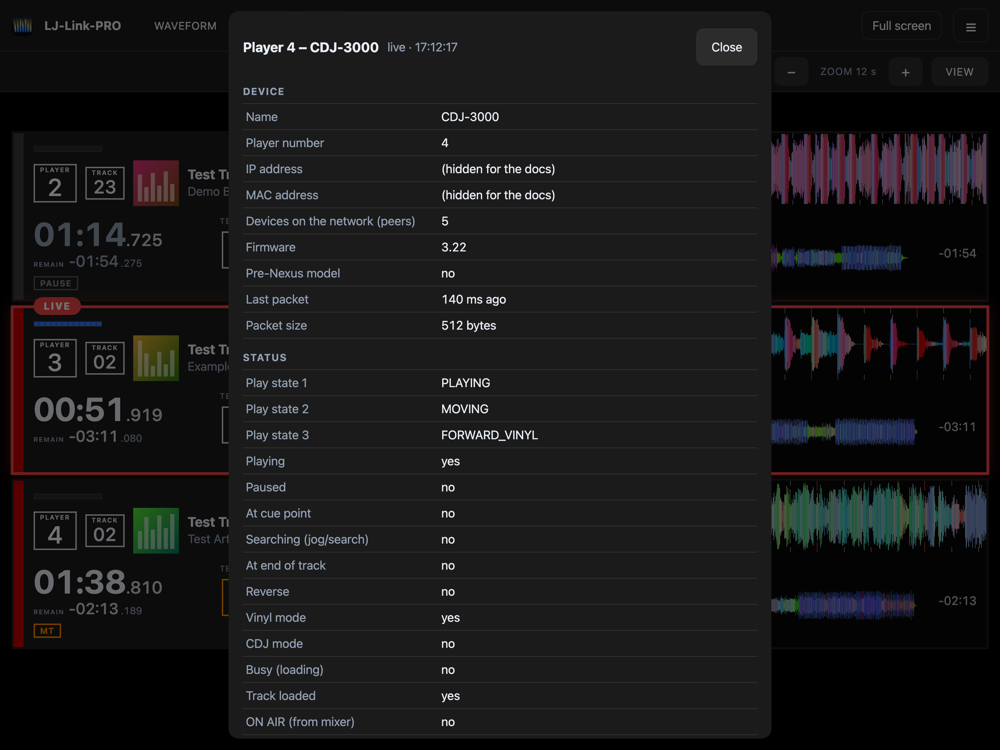<br><sub><b>Player details.</b> Everything the interface reports.</sub></td>
    <td>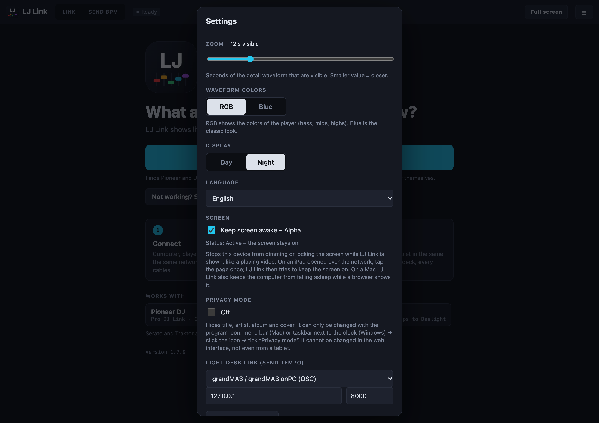<br><sub><b>Settings</b> with the light desk link.</sub></td>
  </tr>
  <tr>
    <td>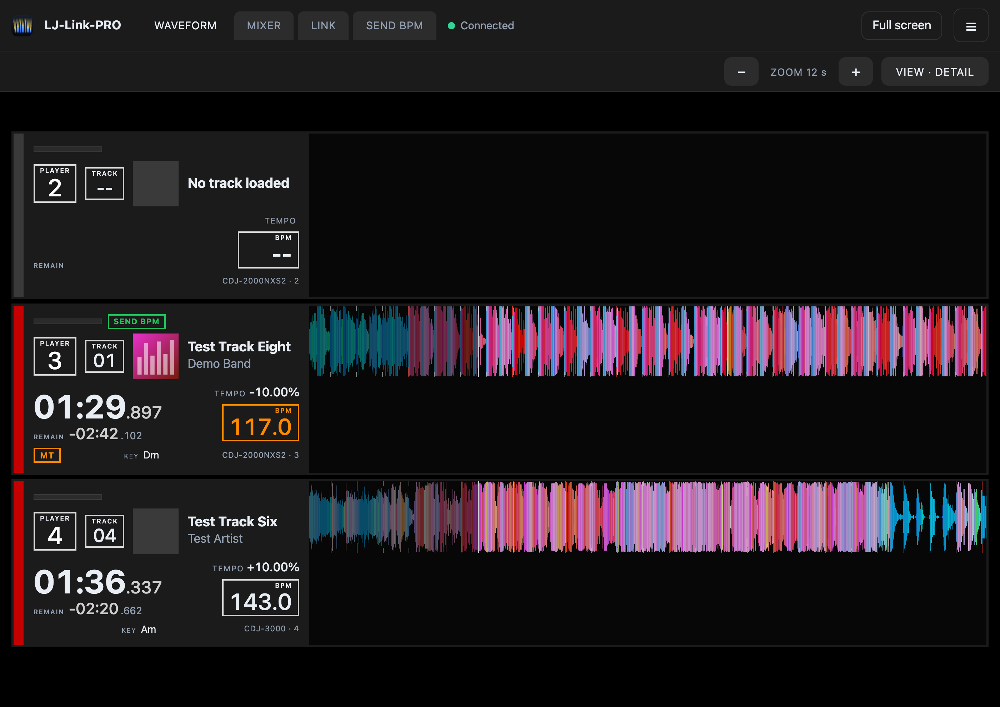<br><sub><b>Detail view.</b> Only the scrolling waveform.</sub></td>
    <td>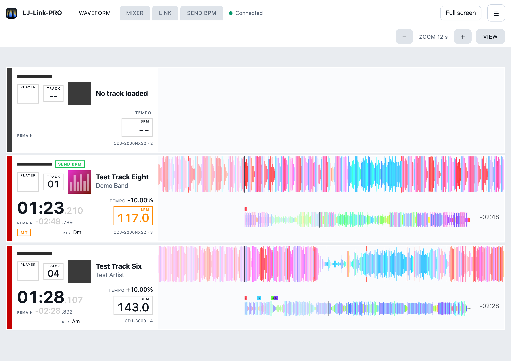<br><sub><b>Day mode</b> for bright rooms.</sub></td>
  </tr>
  <tr>
    <td>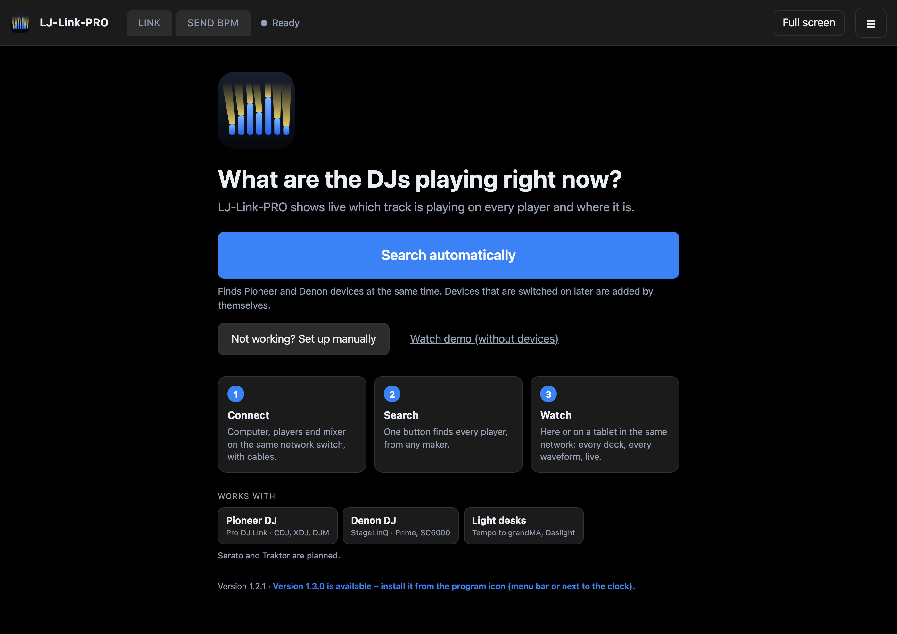<br><sub><b>Start.</b> One button to find the players.</sub></td>
    <td>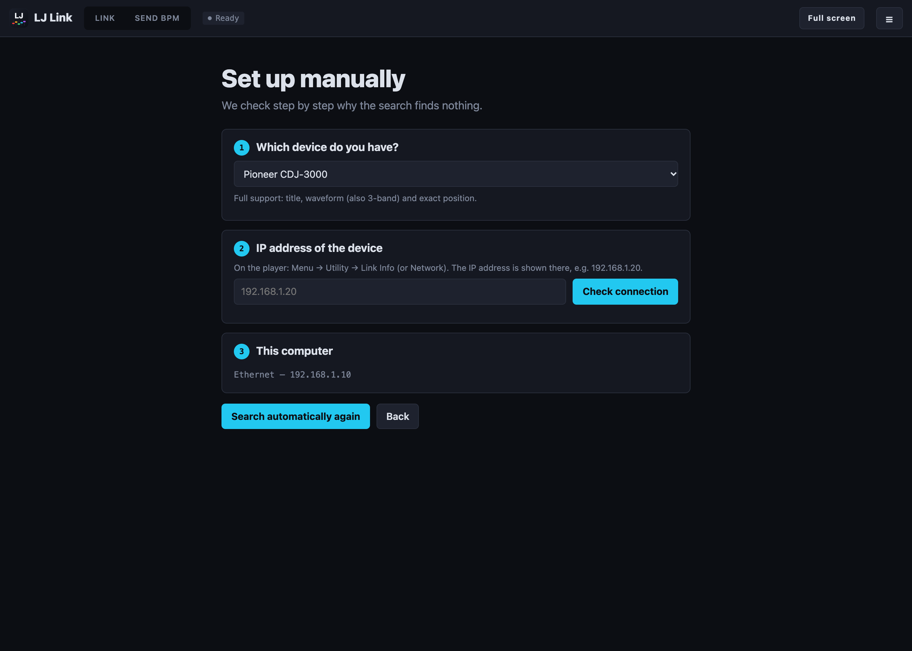<br><sub><b>Manual setup</b> when the search finds nothing.</sub></td>
  </tr>
</table>

## Install

Download the installer for your computer from the [latest release](https://github.com/skyplayser/LJ-Link/releases/latest).
Java is included.

| System | File |
|---|---|
| macOS, Apple Silicon (M1 and newer) | `LJ-Link-macos-arm64.dmg` |
| macOS, Intel | `LJ-Link-macos-intel.dmg` |
| Windows | `LJ-Link-windows.exe` |

Up to version 1.7.7 the files were called `LJ-Link-PRO-…`; for a while each release also carries copies under the old
names, so older versions still find their update.

The installers are not signed yet, so both systems warn once on the first start:

- **macOS** (“LJ Link” Not Opened): drag the app to *Applications* and start it once, click *Done*. Open *System Settings →
  Privacy & Security*, scroll down, click **Open Anyway** next to LJ Link and confirm with your password, then *Open*. Allow
  *Local Network* access when asked. On macOS 14 and older, right-click the app → *Open* also works. Terminal alternative:
  `xattr -dr com.apple.quarantine "/Applications/LJ Link.app"`.
- **Windows** (“Windows protected your PC”): click **More info**, then **Run anyway**. When the firewall asks, tick *Private
  networks* and allow access.

The [website](https://skyplayser.github.io/LJ-Link/#install) shows the steps in detail.

After the start you get an icon in the menu bar (macOS) or next to the clock (Windows). Click it to open the web interface,
switch privacy mode or quit.

## Quick start

1. Connect the computer, all players and the mixer to the same network switch with cables. Turn Wi-Fi off on the computer.
2. Start LJ Link and press **Search automatically**. It finds Pioneer and Denon devices at the same time.
3. Nothing found? Press **Set up manually**; it checks the network step by step and explains what to change.
4. Load tracks: on Pioneer from a rekordbox USB stick or SD card (they need rekordbox analysis), on Denon from the device's
   library (analysed by Engine DJ or on the device).
5. For a tablet, open the address shown in the interface on the same network.

Not an English speaker? *Settings → Language* switches to German. The [German guide](docs/anleitung.de.md) walks through
every screen.

## Privacy mode

Tick **Privacy mode** in the menu of the program icon and title, artist, album, genre, label, remixer, comments and cover
disappear. They are not just hidden on the screen: the program stops sending them, so a tablet or any other device on the
network cannot see them either. Waveforms, times, tempo and cues stay.

The web interface only shows that the mode is on, and where to switch it off. There is no way to change it from the web, not
even from the computer's own browser. `--privacy` starts the program in this mode.

<table>
  <tr>
    <td width="50%">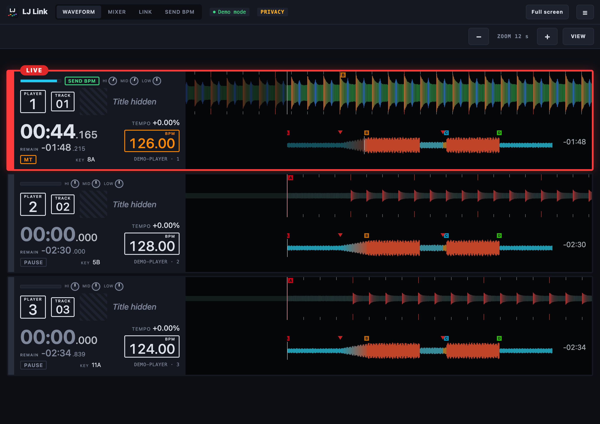<br><sub><b>Privacy mode on.</b> Titles and covers are gone, waveforms and times stay.</sub></td>
    <td width="50%">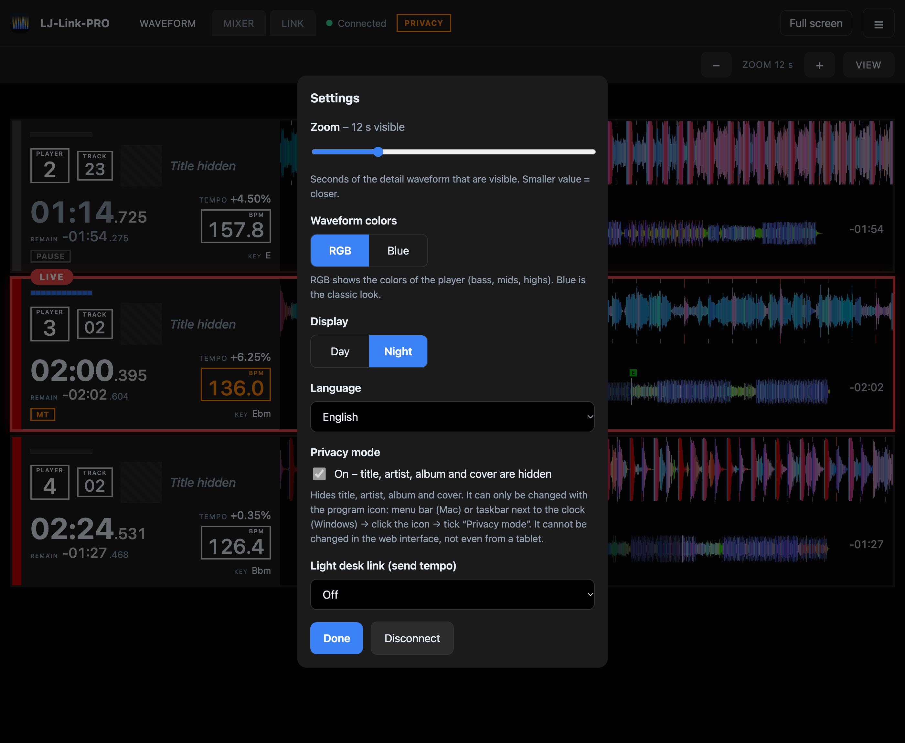<br><sub><b>Settings</b> show the state and where to change it.</sub></td>
  </tr>
</table>

## Light desk link

*Settings → Light desk link* (or the **LINK** tab). Pick your desk, press *Search for the desk* or enter its address
(`127.0.0.1` if onPC runs on the same computer), and press *Send test*.

| Desk | How the tempo gets there | On the desk |
|---|---|---|
| grandMA2, grandMA2 onPC | command line over **Telnet** (TCP 30000), `SpecialMaster 3.16 At {bpm}` (Speed 16 = BPM; Speed 1–15 selectable), whole BPM | Setup → Console → Global Settings → Telnet: *Login Enabled*; a user of the show to log in |
| grandMA3, grandMA3 onPC | command line over **OSC** `/cmd`, `Master 3.1 At BPM {bpm}` | Menu → In & Out → OSC: UDP, port, *Receive Command: Yes*, *Enable Input* |
| Resolume, QLC+ … | the tempo as an **OSC number** to an address | map the address in the program's OSC mapping |
| Daslight (works) | **Ableton Link** (recommended), or an **OSC tap** (value 255, then 0) on every beat | BPM source *Ableton Link Sync*, or map the address to **BPM Tap** in the OSC mappings |
| Wolfmix (via WTOOLS), other OS2L programs — **beta** | **Ableton Link** (recommended for Wolfmix), or **OS2L** over TCP (port 5000): the tempo and every beat | Ableton Link: choose it as the tempo source in WTOOLS; OS2L: start WTOOLS on the computer the Wolfmix is plugged into and switch OS2L on; tried on a Wolfmix W1, guide: [docs/wolfmix-anleitung.de.md](docs/wolfmix-anleitung.de.md) (German) |
| dot2 | not possible: the dot2 takes no Telnet or OSC from the network | tap tempo or sound-to-light |

The step-by-step guide for every desk (German) is in [docs/lichtpult.de.md](docs/lichtpult.de.md). The grandMA2 has no OSC input,
so earlier versions could not reach it; use the grandMA2 (Telnet) choice from 1.3 on.

The search looks for the grandMA2 command line port (TCP 30000) in your networks, so it also finds a console whose remote command
line is switched off. A grandMA3 is not found automatically yet; enter it by hand.

The **SEND BPM** tab decides where the tempo comes from:

| Choice | Tempo from |
|---|---|
| Auto | the tempo master; with two systems (CDJs and a Denon) the master that is also live and playing; without a master the deck that is on air and playing |
| A deck | always that deck, even when another one is live; nothing is sent while it has no track |

The commands come from the MA manuals; the grandMA2 command is **not yet confirmed on a real desk**.
Type the command into the desk's command line by hand first, and edit it in LJ Link to match your show.

## Compatibility

| Device | Status |
|---|---|
| CDJ-3000 | works: status, metadata, waveforms, cues, loops, exact position |
| CDJ-2000NXS2 | works: status, metadata, waveforms, cues, position from beats and beat grid |
| DJM-2000NXS | works as mixer: ON AIR per channel |
| CDJ-2000NXS, XDJ-1000MK2, XDJ-XZ, DJM-900NXS2, DJM-A9, DJM-V10 | expected to work, not tested |
| Denon Prime 4+ (firmware 5.0.4) | works over StageLinQ: title, artist, tempo, play state, master, position, channel faders, waveform, beat grid, cues (loops not yet verified) |
| Denon SC6000, Prime 4, Prime Go | expected to work (same protocol), not tested |
| Serato DJ Pro 3.x (macOS) | works on the same computer: loaded tracks, BPM, key, waveform overview, beat grid; MP3 and AIFF |

“Works” means it ran with LJ Link in our own setups; there is no formal test protocol. Please tell us your setup with the
[*Hardware report*](https://github.com/skyplayser/LJ-Link/issues/new?template=hardware-report.yml) issue template – reports
of what works and what does not help everyone.

## Roadmap

| Target | State |
|---|---|
| Pioneer Pro DJ Link | done |
| Denon / Engine DJ (StageLinQ) | done, several devices at once |
| grandMA2 / onPC (Telnet), grandMA3 / onPC (OSC) | working; grandMA2 found automatically; not yet confirmed on every desk |
| ChamSys MagicQ (OSC tap on every beat, for Tap to Time) | **untested alpha**: checked against a test receiver only, never tried on a real MagicQ |
| Wolfmix / OS2L (beats and tempo) | **beta**: tried on a Wolfmix W1; Ableton Link works better there; the OS2L beat fix of 1.7.3 and the steadier tempo of 1.7.4 are not yet tried on the Wolfmix |
| dot2, MIDI clock out | planned |
| Serato DJ Pro (on the same computer) | track, BPM, key, waveform overview, beat grid, cues; no play position |
| Ableton Link (tempo from Serato, Traktor, rekordbox, Live …) | built in, not yet tried with a real session |
| Ableton Link out (lead the session with the deck's tempo, beats and bars) | works with Daslight; checked against Ableton's Link library |
| Traktor | planned |

The goal is to cover every common DJ standard.

## Good to know

- **Search finds everything:** one press of *Search automatically* looks for Pro DJ Link and Denon StageLinQ devices, Serato DJ Pro on this computer and an Ableton Link session at the same time, and keeps looking while it runs.
- **Serato DJ Pro** has no live interface. LJ Link follows Serato's own log to see which file is on which deck and reads title, BPM, key, waveform overview, beat grid and cues from the tags Serato writes into MP3 and AIFF files. Serato does not reveal the play position, so these decks have no playhead.
- Denon waveforms come from the Engine library on the device's internal drive or card, downloaded once. They have overview resolution (the detail view is smoothed from it), and covers appear only if the library stores them.
- Do not run it on the computer that runs rekordbox. Tracks from streaming services have no waveform data.
- From the mixer, Pro DJ Link only tells us which channels are on air. Fader positions and EQ knobs are **not** transmitted by
  any DJM, so the blue channel bar shows on air or off and the knobs stay empty. Denon devices do report the fader positions
  (the bar then shows the real level); their EQ knobs are not transmitted. The demo mode simulates both to show the layout.
- The CDJ-2000NXS2 did not report an active loop in our tests, the CDJ-3000 does. NXS players report scratching only roughly.
- The player numbers and the mixer channels have to match for ON AIR to be right, and ON AIR also needs sound at the master output.
- **Known bug:** with a direct cable to the players (no router) and Wi-Fi switched on, players sometimes show up twice or not
  at all. Restarting LJ Link usually solves it; switching Wi-Fi off or using a switch avoids it. A fix is being worked on.
- The program joins the Pro DJ Link network as a virtual player with its own number, like beat-link does.
- CDJ-2000NXS2 and older send their position only between beats; LJ Link runs them at their pitch, so the waveform moves
  smoothly. The CDJ-3000 and Denon devices report their exact position.
- Updates need the internet. Without it the program works as before, the check just says it could not reach GitHub.

<details>
<summary>Build from source</summary>

JDK 21 is required.

```bash
./gradlew build          # compile and test
./gradlew installDist    # run with build/install/ljlinkpro/bin/ljlinkpro
./gradlew packageApp     # native installer for the current system in build/installers
```

GitHub Actions builds the installers on every push, and a tag such as `v1.0.0` publishes them as a release. Notes on the
architecture and the decisions behind it are in [docs/decisions.md](docs/decisions.md). Start with
`--no-browser --no-tray --port 8095` while developing and use the demo button to work without hardware.

</details>

## Problems?

The [troubleshooting page](https://skyplayser.github.io/LJ-Link/wiki-troubleshooting.html) lists known problems and their solutions. To report a new one,
use **Report a problem or request a feature** in the program (menu ☰ → Feedback, or the menu of the program icon): describe what
happens and leave *Include diagnostic data* ticked. Wishes are welcome there too, with an optional rating of 1 to 5 stars that
becomes the first line of the report (alpha). The diagnostic data holds the version, network adapters, the devices found and their connection state,
what each deck receives and the last log lines – no track titles, covers or passwords – and can be checked before sending. Send it
by email (your mail program opens a mail to fehlermelden@nextphilm.de) or as a GitHub issue.

## Live use

**LJ Link is free and comes without warranty.** Software, network and devices can fail. Test your setup before the show and
keep a fallback ready, for example tap tempo on the desk.

## Try also: VJ-Link

<a href="https://github.com/skyplayser/VJ-LINK"></a>

**[VJ-Link](https://github.com/skyplayser/VJ-LINK)** is the sister project for live visuals: 150 visuals and 50 effects, run by
your light desk over Art-Net, sACN, MIDI or OSC, on any number of screens, LED walls and projectors, with projection mapping and
camera looks. It takes the tempo, beat phase, phrases and the playing track from LJ Link, so the visuals follow the DJ. Free for
macOS and Windows, now as an alpha.

<br clear="left">

## Credits and notices

Built on [beat-link](https://github.com/Deep-Symmetry/beat-link) by Deep Symmetry and the protocol research of the
[dysentery](https://github.com/Deep-Symmetry/dysentery) project (EPL-2.0). More in [THIRD_PARTY_NOTICES.md](THIRD_PARTY_NOTICES.md).

LJ Link is an independent project. It is not an official product of, and is not endorsed by, any maker of DJ, lighting or
music hardware or software. All product names and trademarks mentioned in LJ Link and its documentation belong to their
respective owners and are used only to describe compatibility. Ableton and Link are trademarks of Ableton AG. LJ Link is not
related to the LightJockey software by Martin.

## License

© 2026 Philipp Spruck / NEXTPHILM. LJ Link is distributed under the [Eclipse Public License 2.0](LICENSE), without any
warranty. The program shows its own license and those of the bundled libraries under *Settings → Licenses*.

<br>

<p align="center">
  <sub><a href="https://skyplayser.github.io/LJ-Link/impressum.html">Legal notice (Impressum)</a> ·
  <a href="https://skyplayser.github.io/LJ-Link/datenschutz.html">Privacy</a><br><br>
  Idea SKYPLAYSER/NEXTPHILM<br>
  Prompted with ❤️ made by Claude</sub>
</p>
