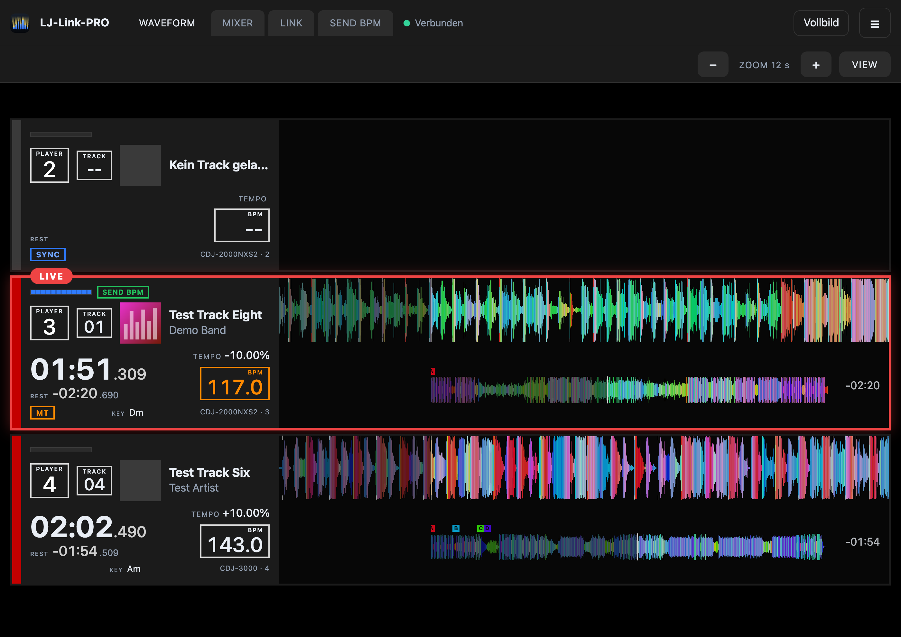
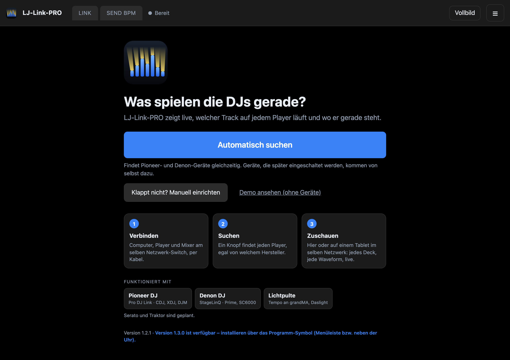
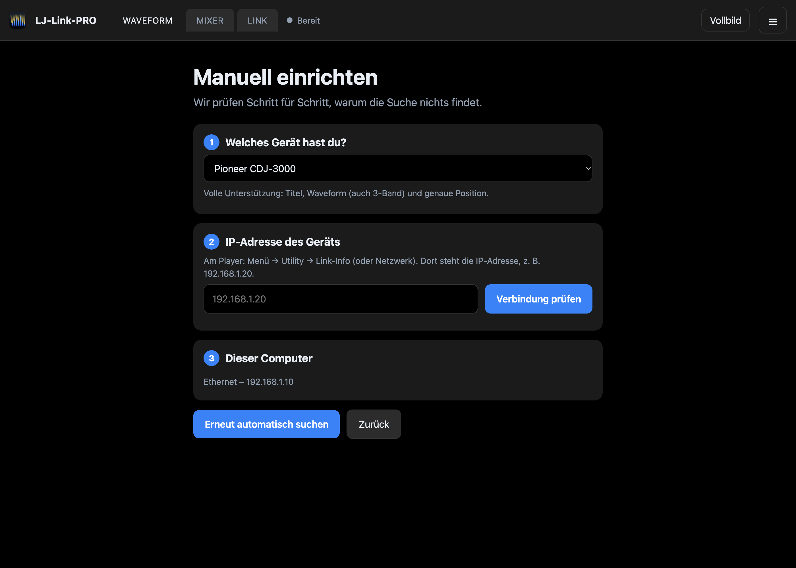
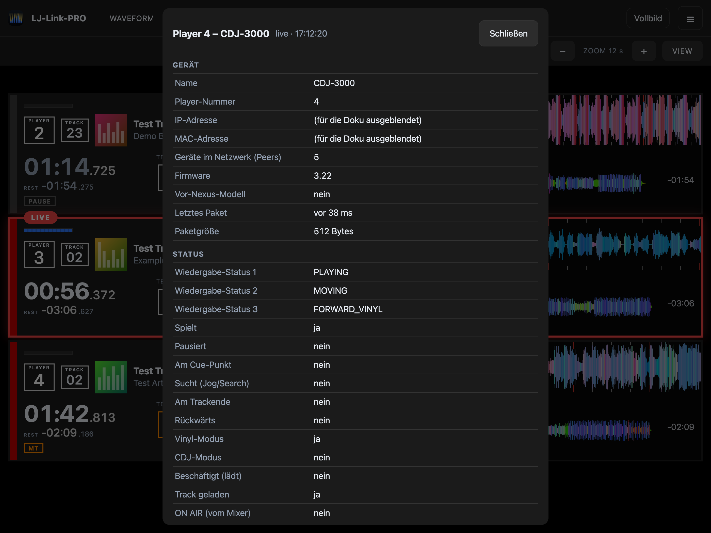
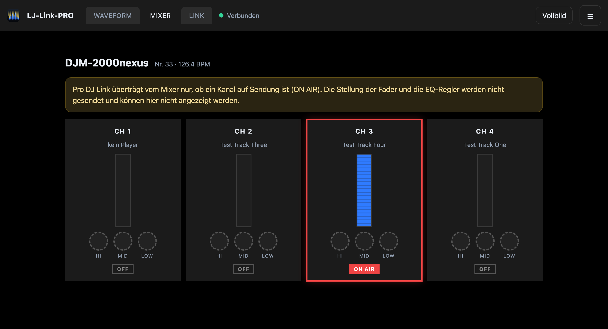
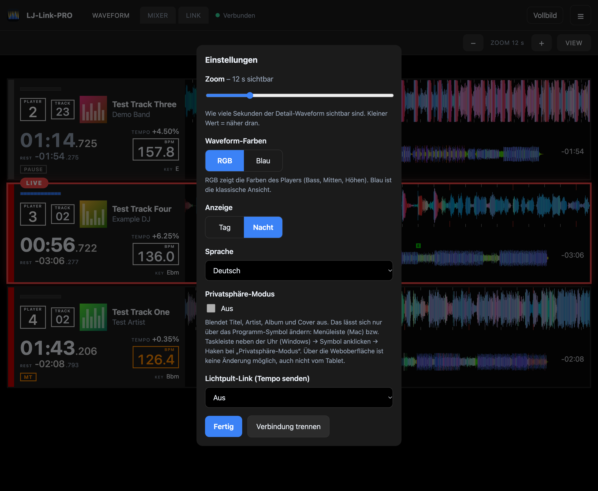
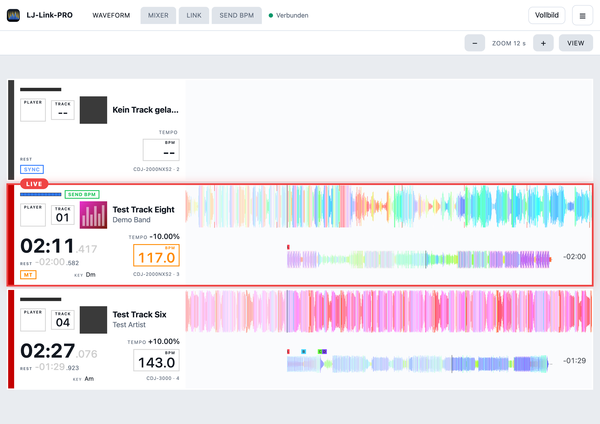
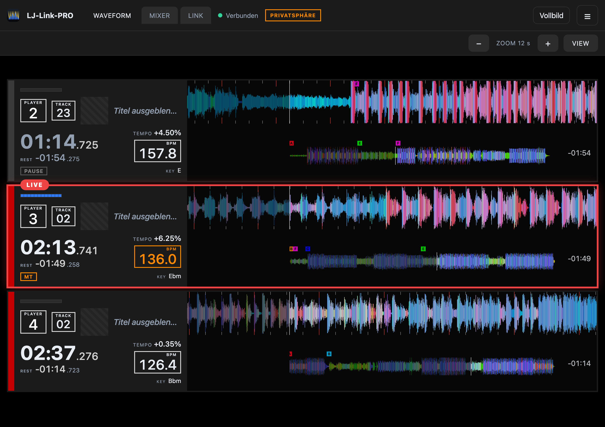
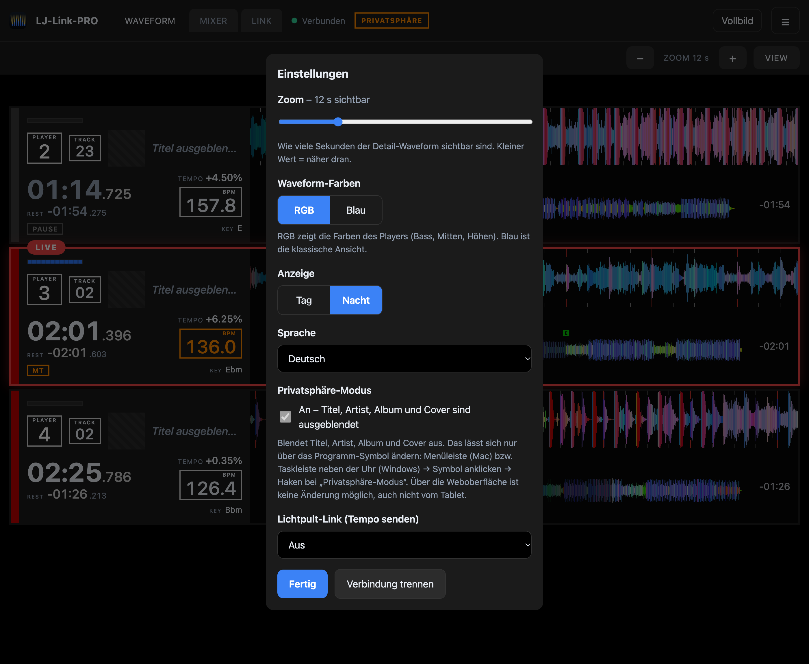
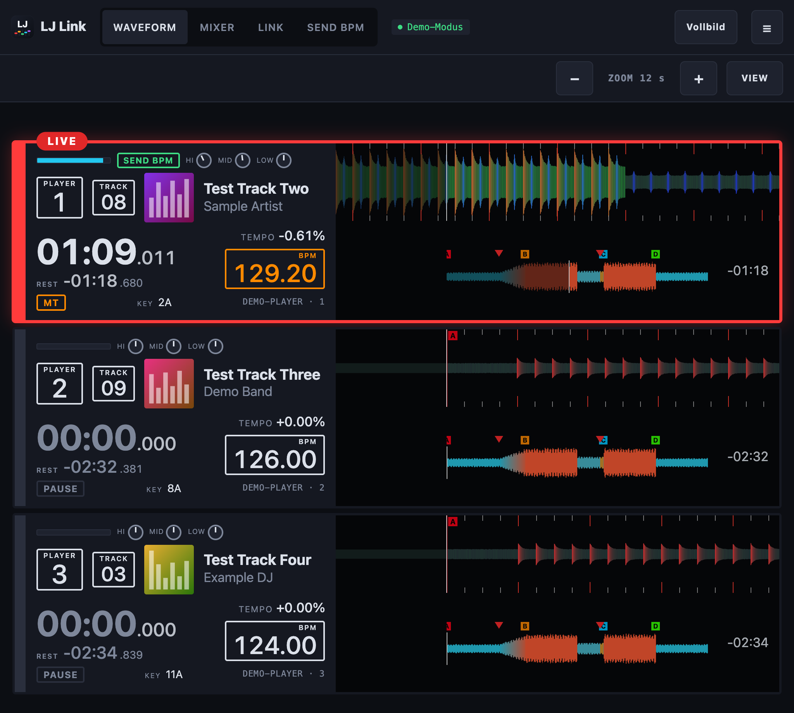

# LJ-Link-PRO – Anleitung

LJ-Link-PRO zeigt dir live, **welcher Track auf jedem DJ-Player läuft und wo er gerade steht**. Gedacht für den Lichtjockey:
Drops und Übergänge rechtzeitig erkennen.



## Inhalt

1. [Was du brauchst](#was-du-brauchst)
2. [Installieren](#installieren)
3. [Netzwerk aufbauen](#netzwerk-aufbauen)
4. [Starten und verbinden](#starten-und-verbinden)
5. [Die Anzeige verstehen](#die-anzeige-verstehen)
6. [Der Reiter Mixer](#der-reiter-mixer)
7. [Einstellungen und Sprache](#einstellungen)
8. [Tablet oder zweiter Bildschirm](#tablet-oder-zweiter-bildschirm)
9. [Lichtpult-Link](#lichtpult-link)
10. [Fehlerbehebung](#fehlerbehebung)

## Was du brauchst

- Einen Computer mit **macOS** oder **Windows**.
- DJ-Player und Mixer von Pioneer DJ mit **Pro DJ Link** (zum Beispiel CDJ-3000, CDJ-2000NXS2, DJM-2000NXS).
- Netzwerkkabel und einen **Netzwerk-Switch** (oder die Link-Anschlüsse des Mixers).
- Tracks von einem **rekordbox-USB-Stick oder einer SD-Karte**, in rekordbox analysiert und exportiert.

## Installieren

Lade die Datei für deinen Computer von der [Releases-Seite](../../../releases):

| System | Datei |
|---|---|
| Mac mit Apple-Chip (M1 und neuer) | `LJ-Link-PRO-macos-arm64.dmg` |
| Mac mit Intel-Prozessor | `LJ-Link-PRO-macos-intel.dmg` |
| Windows | `LJ-Link-PRO-windows.exe` |

Die Installer sind noch nicht bei Apple bzw. Microsoft signiert. Deshalb warnen beide Systeme **einmal** beim ersten Start.
Das sagt nichts über die Sicherheit aus. So geht es weiter:

### Mac: „LJ-Link-PRO“ nicht geöffnet

Meldung: *Apple konnte nicht überprüfen, ob „LJ-Link-PRO“ frei von Schadsoftware ist …*

1. `.dmg` öffnen und *LJ-Link-PRO* in den Ordner **Programme** ziehen.
2. LJ-Link-PRO einmal starten. Die Warnung erscheint: **Fertig** klicken (nicht *In den Papierkorb legen*).
3. **Systemeinstellungen** öffnen → **Datenschutz & Sicherheit** → ganz nach unten scrollen.
4. Bei *„LJ-Link-PRO“ wurde blockiert …* auf **Dennoch öffnen** klicken und mit Passwort oder Touch ID bestätigen.
5. Im nächsten Fenster noch einmal **Öffnen** wählen.
6. Fragt macOS nach dem **lokalen Netzwerk**: **Erlauben**. Ohne das findet LJ-Link-PRO keine Player.

Bis macOS 14 reicht auch: Rechtsklick auf die App → *Öffnen* → *Öffnen*. Für Profis per Terminal (danach keine Warnung mehr):

```bash
xattr -dr com.apple.quarantine /Applications/LJ-Link-PRO.app
```

### Windows: „Der Computer wurde durch Windows geschützt“

1. `LJ-Link-PRO-windows.exe` starten.
2. Im blauen SmartScreen-Fenster auf **Weitere Informationen** klicken.
3. **Trotzdem ausführen** klicken und den Installer durchklicken.
4. Beim ersten Start fragt die Firewall: **Private Netzwerke** anhaken und **Zugriff zulassen**. Ohne das findet LJ-Link-PRO keine
   Player.

Firewall-Frage verpasst? *Windows-Sicherheit → Firewall- & Netzwerkschutz → App durch die Firewall zulassen* → LJ-Link-PRO für
*Privat* anhaken.

## Netzwerk aufbauen

1. Alle **Player und den Mixer** per Netzwerkkabel mit demselben **Switch** verbinden.
2. Den **Computer** ebenfalls per Kabel an denselben Switch. Mit USB-Ethernet-Adapter, falls nötig.
3. **WLAN am Computer ausschalten**, damit die richtige Verbindung benutzt wird.
4. An den Playern die **Player-Nummern 1, 2, 3 …** vergeben (jede Nummer nur einmal).
5. Stick oder SD-Karte in die Player stecken, Tracks laden.

> **Nicht** auf dem Computer starten, auf dem rekordbox läuft. Beide stören sich gegenseitig.

## Starten und verbinden

Nach dem Start erscheint ein Symbol in der **Menüleiste** (Mac, oben rechts) oder neben der **Uhr** (Windows, unten rechts).
Ein Klick darauf öffnet die **Weboberfläche**, schaltet den **Privatsphäre-Modus** ein oder beendet das Programm.



1. **Automatisch suchen** (englisch: *Search automatically*) klicken. Die Oberfläche ist standardmäßig englisch: unter ☰ → *Language* auf *Deutsch* stellen. Das Programm sucht im Netzwerk nach Playern und verbindet sich selbst.
2. Sobald ein Gerät gefunden ist, erscheint es in der Liste und danach die Anzeige.
3. Du willst es erst ohne Geräte ausprobieren? **Demo ansehen** zeigt drei simulierte Player.

### Denon-Geräte (Prime 4+, SC6000, Prime Go)

Denon-Geräte findet **Automatisch suchen** zusammen mit den Pioneer-Geräten. Das Gerät muss im selben Netzwerk hängen
(Netzwerkkabel oder WLAN, wie bei Engine DJ). LJ-Link-PRO zeigt dann Titel, Artist, Tempo, Spielstatus, Master, Laufzeit, Restzeit
und die **echten Fader-Stellungen** des Mixers im blauen Balken. Die Waveform mit Beatgrid und Cues liest das Programm aus der Bibliothek des Geräts (Engine Library). Sie hat nur die Auflösung der Übersicht, die Detailansicht ist daraus geglättet; Cover erscheinen nur, wenn die Bibliothek welche enthält.
Nach einem Abbruch braucht das Gerät manchmal einige Sekunden, bis es eine neue Verbindung annimmt.

### Mehrere Geräte gleichzeitig

Alles, was gefunden wird, erscheint nebeneinander in der Waveform-Ansicht, egal von welchem Hersteller: CDJs, XDJs und Denon-Controller.
Bringen zwei DJs je einen eigenen Controller mit, erscheinen beide. Ein Gerät, das später dazukommt, wird automatisch hinzugefügt;
eines, das geht, verschwindet nach wenigen Sekunden. Bei vielen Geräten oder mehreren Floors kannst du sie unter
**Einstellungen → Geräte** per Haken ein- und ausblenden. Der Mixer-Tab zeigt einen Block pro Mixer.

### Wenn die Suche nichts findet: Manuell einrichten



1. Wähle dein Gerät aus der Liste. Darunter steht, was mit diesem Gerät möglich ist.
2. Trage die **IP-Adresse** des Players ein. Du findest sie am Player unter *Menü → Utility → Link-Info*.
3. **Verbindung prüfen** zeigt Schritt für Schritt Haken und Kreuze, zum Beispiel ob Computer und Player im selben Netzwerk
   liegen, und sagt dir, was du ändern musst.
4. Danach **Erneut automatisch suchen**.

> Hinweis: Die Geräte lassen sich nicht direkt über ihre IP-Adresse ansprechen, sie melden sich selbst im Netzwerk. Die
> manuelle Einrichtung ist deshalb eine Hilfe zur Fehlersuche.

## Die Anzeige verstehen

Jeder Player ist eine Zeile. Links stehen die Daten des Players, rechts die Waveforms.

| Element | Bedeutung |
|---|---|
| **PLAYER / TRACK** | Nummer des Players und des Tracks auf dem Medium |
| **Cover, Titel, Artist** | der geladene Track |
| **Große Zeit** | gespielte Zeit in Minuten, Sekunden und Millisekunden; darunter **REST** mit der verbleibenden Zeit |
| **TEMPO** | Abweichung vom Originaltempo in Prozent (Pitch) |
| **BPM-Kasten** | aktuelles Tempo; **orange** beim Master-Player |
| **MT / SYNC / PAUSE** | Tempo-Master, Sync aktiv, Player pausiert |
| **KEY** | Tonart des Tracks |
| **Blauer Balken und HI/MID/LOW-Knöpfe** (oben links im Deck) | Kanal des Mixers: Der Balken zeigt, ob der Kanal auf Sendung ist. Die Knöpfe erscheinen nur, wenn die Quelle EQ-Werte liefert (siehe [Reiter Mixer](#der-reiter-mixer)) |
| **Rote LIVE-Umrandung** | dieser Player ist über den Mixer **auf Sendung** (ON AIR) |
| **Obere Waveform** | der Track läuft von rechts nach links am Playhead vorbei. Der schon gespielte Teil ist abgedunkelt |
| **Untere Waveform** | der ganze Track mit Playhead, rechts die **Restzeit** |
| **Farbige Flaggen A–H** | Hot Cues in den Farben aus rekordbox |
| **Rote Dreiecke** | Memory-Cues |
| **Orange Bereich** | **Loop**: gespeicherte Loops blasser, der gerade aktive Loop kräftig, mit der Länge in Beats (↻ 8) |
| **Striche am Rand** | Beat-Raster, **rot** am Taktanfang |



**Klick auf einen Player** öffnet alle Informationen, die der Player über die Schnittstelle meldet: Gerät, Status, Tempo, Loop,
Medium, Track, Position, Cues und das rohe Datenpaket. Die Werte aktualisieren sich jede Sekunde.

## Der Reiter Mixer



Neben **WAVEFORM** gibt es den Reiter **MIXER**. Er zeigt die Kanäle des Mixers: Name und Nummer des Mixers, pro Kanal den
Player, einen Fader-Balken, die Regler **HI, MID, LOW** und ob der Kanal **ON AIR** ist.

> **Wichtig:** Das Pro-DJ-Link-Netzwerk von Pioneer überträgt nur, **ob** ein Kanal auf Sendung ist. Die **Stellung der Fader** und
> die **EQ-Regler** werden von keinem DJM über Pro DJ Link gesendet. Mit einem Pioneer-Mixer zeigt der Balken deshalb nur
> „auf Sendung“ oder „aus“, und die Knöpfe bleiben leer. Im **Demo-Modus** siehst du simulierte Werte (gekennzeichnet mit
> *SIMULIERT*), damit klar ist, wie die Anzeige aussieht. Echte Fader- und EQ-Werte wären über USB-MIDI des Mixers oder bei
> Denon über StageLinQ möglich; bei Denon ist das umgesetzt.

## Einstellungen

Oben rechts im Menü (☰) und in der Werkzeugleiste:



- **Zoom** (− und +): wie viele Sekunden der oberen Waveform sichtbar sind.
- **VIEW:** wechselt zwischen *beide Waveforms*, *nur Detail* und *nur Übersicht*.
- **Waveform-Farben:** RGB (wie am Player) oder klassisch Blau.
- **Anzeige:** **Tag** oder **Nacht**.
- **Sprache:** Englisch (Standard) oder Deutsch. Die Wahl gilt für diesen Browser; das Menü des Programm-Symbols folgt der Sprache, die am Computer selbst eingestellt ist.
- **Vollbild** für den Einsatz am Pult.
- **Verbindung trennen** beendet die laufende Verbindung.

Die Einstellungen werden im Browser gespeichert.



### Privatsphäre-Modus

Für Streams, Fotos oder geteilte Bildschirme: Auf das **Programm-Symbol** klicken (Menüleiste beim Mac, neben der Uhr bei Windows) und
den Haken bei **Privatsphäre-Modus** setzen. Das Programm sendet dann **gar keine** Titel, Artists, Alben, Genres, Labels, Remixer,
Kommentare und Cover mehr, auch nicht an Tablets oder andere Computer im Netzwerk. Waveforms, Zeiten, Tempo und Cues bleiben sichtbar.

In der Weboberfläche siehst du nur den Zustand (Hinweis **PRIVATSPHÄRE**) und den Hinweis, dass man den Modus ausschließlich über das
Programm-Symbol ändert. Mit `--privacy` startet das Programm in diesem Modus.





## Tablet oder zweiter Bildschirm

Unter der Werkzeugleiste steht eine Adresse wie `http://192.168.1.50:8080`. Gib sie auf einem Tablet oder Laptop im **selben
Netzwerk** im Browser ein. Dort siehst du dieselbe Anzeige. Zum Starten und Beenden ist weiterhin der Computer nötig, auf dem
LJ-Link-PRO läuft.



## Lichtpult-Link

LJ-Link-PRO kann das **Tempo** an dein Lichtpult senden, damit Effekte im Takt laufen: an grandMA2 und grandMA2 onPC über
Telnet, an grandMA3 und grandMA3 onPC über OSC, an Daslight und andere Programme als OSC-Zahl. Der dot2 lässt sich über das
Netzwerk nicht ansteuern.

Kurz: Menü (☰) oder Reiter **LINK** → Pult wählen → **Pult suchen** (grandMA2) oder IP eintragen → bei grandMA2 Benutzer und
Passwort → **Speichern** → **Test senden**. Welches Deck das Tempo liefert, legt der Reiter **SEND BPM** fest.

**Die ausführliche Schritt-für-Schritt-Anleitung für jedes Pult steht in [lichtpult.de.md](lichtpult.de.md).**

## Fehlerbehebung

**Die Suche findet nichts.**
- Sind Player und Computer am selben Switch? Brennt am Netzwerkanschluss das Licht?
- WLAN am Computer ausschalten.
- Mac: *Systemeinstellungen → Datenschutz & Sicherheit → Lokales Netzwerk* – LJ-Link-PRO muss erlaubt sein.
- Windows: Firewall-Frage mit *Zugriff zulassen* für **private Netzwerke** bestätigen.
- Läuft rekordbox auf diesem Computer? Beenden.
- Weiter mit **Manuell einrichten**: die Prüfung nennt den Grund.

**Titel und Waveform fehlen.**
- Die Tracks müssen von einem rekordbox-Stick oder einer SD-Karte kommen. Streaming-Tracks haben keine Analysedaten.
- Bei mehr als einem Player kann das Laden einige Sekunden dauern.

**Die Anzeige ruckelt oder hängt beim Scratchen.**
- Der CDJ-3000 meldet seine Position sehr genau. NXS und NXS2 melden Scratchen nur grob, dort ist die Anzeige technisch begrenzt.
- Wenn das Netzwerk stark belastet ist, hilft ein eigener Switch nur für die DJ-Geräte.

**Das Programm lässt sich unter macOS nicht öffnen.**
- Rechtsklick auf das Programm → *Öffnen* → *Öffnen*.

**Das Symbol in der Menüleiste fehlt.**
- *Systemeinstellungen → Menüleiste*: prüfen, ob LJ-Link-PRO angezeigt werden darf. Bei voller Menüleiste blendet macOS Symbole aus.

**Zwei Netzwerkkarten (Mac).** Hängt der Computer in zwei Netzwerken, wählt das Programm den Anschluss automatisch anhand des
Netzwerks der Player. Die Liste unter *Manuell einrichten* zeigt, welche Anschlüsse es gibt.

Weiterhin Probleme? Öffne ein Issue mit der Vorlage **Hardware report** und beschreibe Geräte, Firmware und was du siehst.

## BPM senden: welches Deck das Tempo liefert

Ist der Lichtpult-Link eingeschaltet, legt der Reiter **SEND BPM** oben fest, von welchem Deck das Tempo kommt:

- **Auto:** das Deck, das Master und/oder live ist. Bei zwei Systemen (z. B. CDJs und ein Denon) gewinnt der Master, der auch live ist und spielt.
- **Manuell:** ein bestimmtes Deck, auch wenn ein anderes live ist. Hat es gerade kein Tempo (kein Track), wird nichts gesendet und das Fenster sagt es.

Das Fenster zeigt laufend, welches Tempo von welchem Deck gesendet wird. Die Wahl bleibt nach einem Neustart erhalten und lässt sich nur am Computer selbst ändern, nicht vom Tablet.

